<h1 align="center">Krill</h1>

<p align="center"><b>A Solana DAO where many small voters outweigh one whale.</b><br>
Quadratic voting with exact integer math, and a milestone escrow that pays contractors one approved step at a time.</p>

<p align="center">
  <a href="https://github.com/DervinEvolve/krill/actions/workflows/ci.yml"></a>
  <a href="docs/VERIFIED_BUILD.md"></a>
  
  
  
  <a href="LICENSE"></a>
</p>

<p align="center">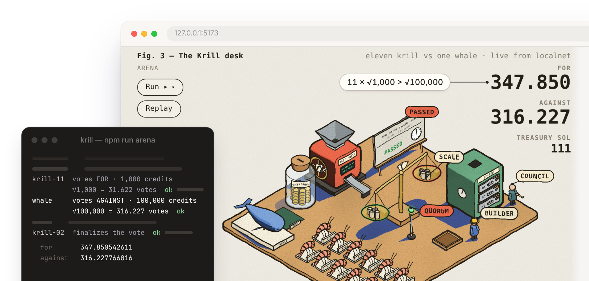</p>
<p align="center"><sub>Eleven agents holding 1 SOL each out-vote one agent holding 100 SOL, on a real local validator. 11 × √1,000 > √100,000.</sub></p>

**Live demo:** https://dervinevolve.github.io/krill/ plays back a recorded run of the Arena in your browser. Nothing to install.

---

## Why "Krill"

Krill are tiny. A whale eats millions of them in a day. Put every krill in the ocean on a scale and they outweigh every whale alive.

The name comes from that. Most token voting gives you votes in proportion to your balance, so one wallet with 100x the money gets 100x the votes and decides everything. Krill uses **quadratic voting** instead: your votes are the **square root** of what you spend. 100x the money gets you 10x the votes. Eleven members with 1 SOL each can beat one member with 100 SOL.

Whales can still join. A whale still outweighs any single small member, just not all of them together.

I do this for fun. I started on Solana because I know the chain best. The ideas here (square-root votes, milestone escrow, the state machine) would work on any chain. The code would not: it is Anchor through and through, lol. I will try other chains eventuallyy

## What it does

1. **Members pool SOL** into a DAO treasury and receive *voice credits* (1 credit per 0.001 SOL).
2. **Members vote on spending proposals** by burning credits. Votes = √credits, computed on-chain with exact integer arithmetic (no floating point).
3. **A passed proposal moves its SOL into an escrow** split into milestones. The contractor submits each milestone in order; a council approves (pays) or rejects (sends back). Cancelling returns every unreleased lamport to the treasury.

| Term | Meaning in this repo |
|---|---|
| **Whale** | A member whose deposit dwarfs everyone else's. In the tests: 100 SOL. |
| **Krill** | A small member. In the tests: 1 SOL. Eleven of them. |
| **Voice credit** | The unit you spend to vote. 1 credit = 0.001 SOL deposited. Credits are burned when spent. |
| **Vote** | √credits, stored as a fixed-point number with 9 decimals (`1.5 votes == 1_500_000_000`). |
| **Council** | The key that reviews milestones. Meant to be a multisig. It can pay the contractor or return funds to the treasury, nothing else. |
| **Contractor** | The wallet a proposal names to do the work and receive milestone payments. |
| **Milestone escrow** | A program-owned account holding the proposal's SOL, released one approved milestone at a time. |

## How quadratic voting works here

A member who deposits 1 SOL holds 1,000 credits. Spending all of them buys √1,000 ≈ 31.62 votes. A whale with 100 SOL holds 100,000 credits and buys √100,000 ≈ 316.23 votes. 100x the money, 10x the votes.

| Deposit | Credits | Votes (on-chain value) |
|---|---|---|
| 0.001 SOL | 1 | 1.000000000 |
| 0.004 SOL | 4 | 2.000000000 |
| 1 SOL | 1,000 | 31.622776601 |
| 10 SOL | 10,000 | 100.000000000 |
| 100 SOL | 100,000 | 316.227766016 |
| 11 × 1 SOL | 11 × 1,000 | **347.850542611** |

<p align="center">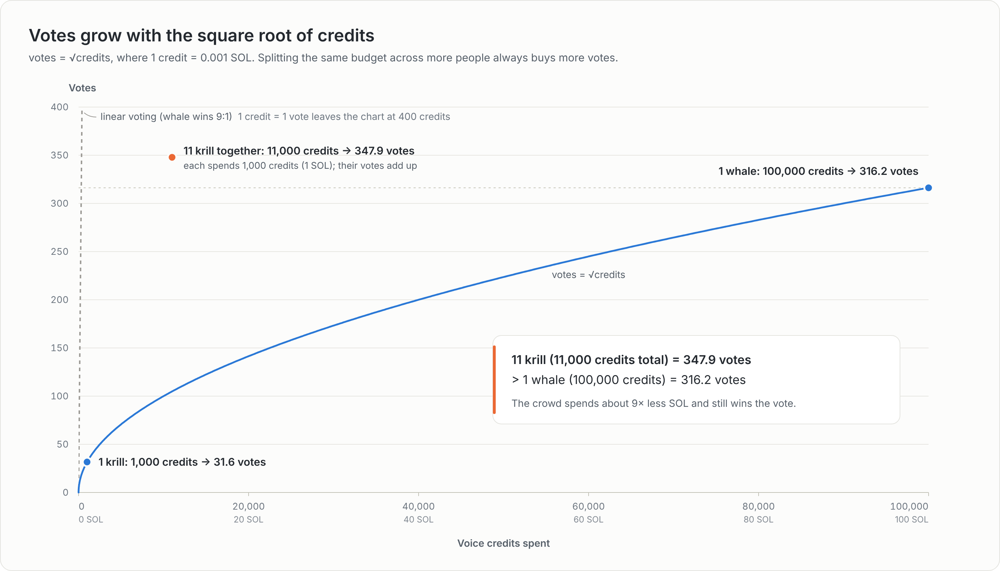</p>

Two rules close the obvious ways to game it (the less obvious one is in the next section):

- **The square root is taken on each voter's cumulative credits, never per transaction.** If you vote 400 credits and later add 500 more, you hold √900 = 30 votes, not √400 + √500 = 42.36. Without this rule, anyone could split a big vote into many small ones and get linear voting back. The program keeps a `VoteReceipt` per voter per proposal and adjusts the tally by the *difference* between the new and the old square root.
- **You cannot switch sides.** Once a receipt is "for", every top-up is "for". Switching would let a voter move tallies around for free.

An interactive figure of the same math lives in [`docs/figures/quadratic-voting`](docs/figures/quadratic-voting) (open the HTML file):

<p align="center">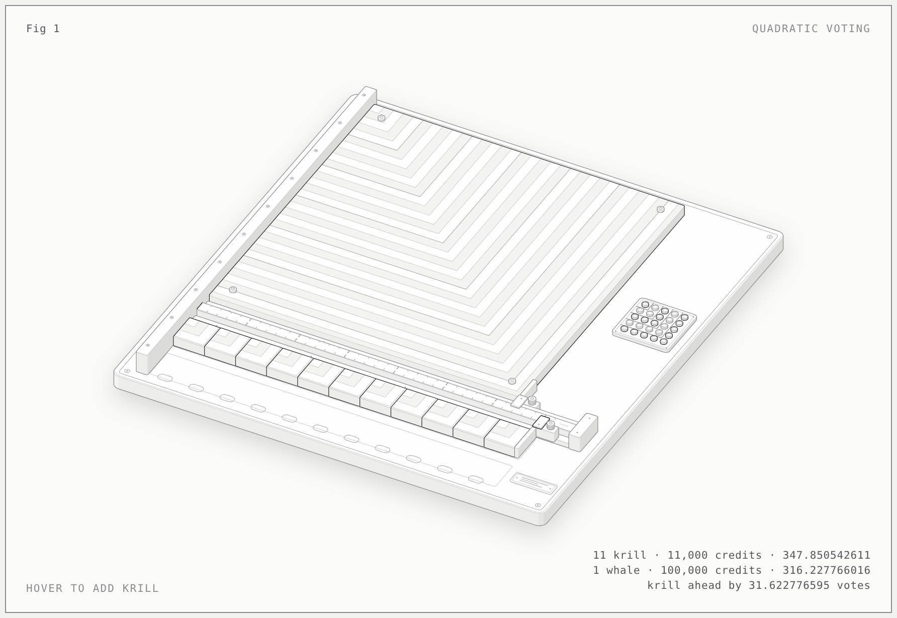</p>
<p align="center"><sub>Each plate's area is a member's credits, so its edge is √credits, the votes. Eleven krill plates laid end to end reach 347.850542611 on the ruler and pass a 100 SOL whale at 316.227766016, with about a ninth of the money. Hover to add krill one at a time.</sub></p>

### The catch

Quadratic voting assumes one identity per voter. Nothing on-chain stops a whale from splitting 100 SOL across eleven fresh wallets. The arena has a scenario that does exactly that, and the whale wins. A real deployment needs an identity or stake-lock layer on top. I have not built one.

## Fixed-point square root without floats

Solana programs cannot use `f32`/`f64` in a way that is safe for consensus: every validator must produce bit-identical results, and floating point rounding can differ between machines. So the square root is integer math only.

```rust
/// Floor square root of a u128. Newton's method seeded from the bit length,
/// which is an upper bound on sqrt(n), so the sequence is monotonically
/// decreasing and terminates in at most ~7 iterations for u128 input.
pub fn isqrt(n: u128) -> u128 {
    if n < 2 {
        return n;
    }
    let bits = 128 - n.leading_zeros();
    let mut x = 1u128 << bits.div_ceil(2); // 2^ceil(bits/2) >= sqrt(n)
    loop {
        let y = (x + n / x) / 2;
        if y >= x {
            return x;
        }
        x = y;
    }
}

/// floor( sqrt(credits) * VOTE_SCALE ) == isqrt(credits * VOTE_SCALE²)
pub fn votes_for(credits: u64) -> u128 {
    isqrt(u128::from(credits) * VOTE_SCALE * VOTE_SCALE)
}
```

Models helped me with this math, so check my work. The three arguments below take a minute to read, and the tests after them are how I checked it myself.

Why I believe it is correct:

- **It terminates.** The seed `2^ceil(bits/2)` is at least √n, and Newton's step from above only ever decreases until it would increase, which is exactly the floor.
- **It cannot overflow.** The seed is at most 2^64, every later `x` is smaller, and `n / x < 2^64`, so `x + n / x` fits in u128 with 63 bits to spare. For `votes_for`, `credits < 2^64` and `VOTE_SCALE² < 2^60`, so the product is below 2^124.
- **It rounds down.** A voter never gets more votes than they paid for.

The tests:

- every `n` from 0 to 2^20 is checked against `r² ≤ n < (r+1)²`;
- every power of two in u128, ± 1, plus `u64::MAX` and `u128::MAX`;
- a property test over random u128 inputs, and a monotonicity check;
- the **concavity property** `votes_for(a) + votes_for(b) ≥ votes_for(a + b)`, (splitting a budget among more people never loses votes);
- a guard test that reads the program's own source and fails if `f32` or `f64` ever appears.

## The state machine

Each arrow is one instruction. Every instruction checks the current state, and either who is signing or what time it is.

<p align="center">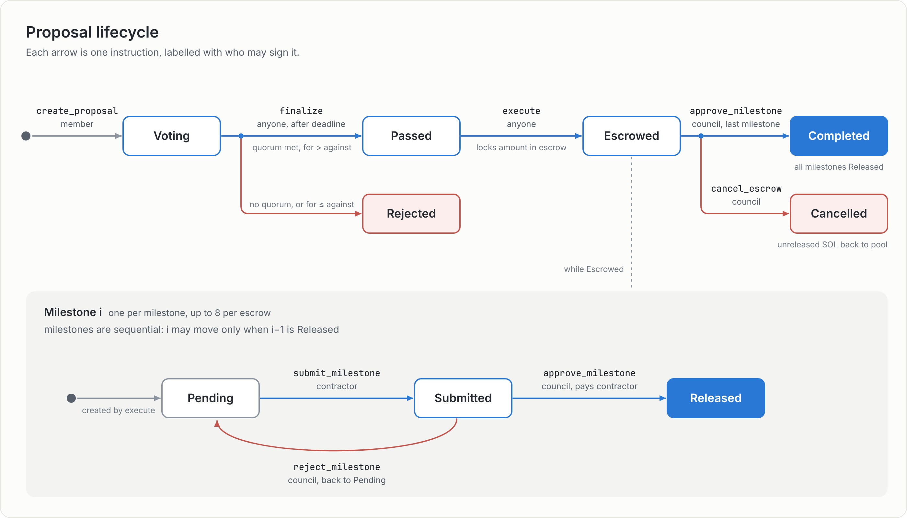</p>

| From | Instruction | Who | To | Guard |
|---|---|---|---|---|
| — | `create_proposal` | any member | `Voting` | 1–8 milestones, each > 0, total ≤ treasury |
| `Voting` | `cast_vote` | any member | `Voting` | before the deadline; credits ≤ balance; same side as before |
| `Voting` | `finalize` | anyone | `Passed` / `Rejected` | after the deadline; passes iff credits spent ≥ quorum **and** for > against |
| `Passed` | `execute` | anyone | `Escrowed` | treasury still covers the amount; creates the escrow and moves the SOL in one step |
| `Escrowed` | `approve_milestone` (last one) | council | `Completed` | all milestones released |
| `Escrowed` | `cancel_escrow` | council | `Cancelled` | unreleased SOL returns to the treasury |

Quorum is a snapshot: when a proposal is created it records `total_credits × quorum_bps / 10_000`, so later deposits do not change the quorum of a vote already in progress.

## Milestone escrow

Escrowed SOL has two ways out: to the contractor when the council approves a milestone, or back to the treasury when the council cancels.

<p align="center">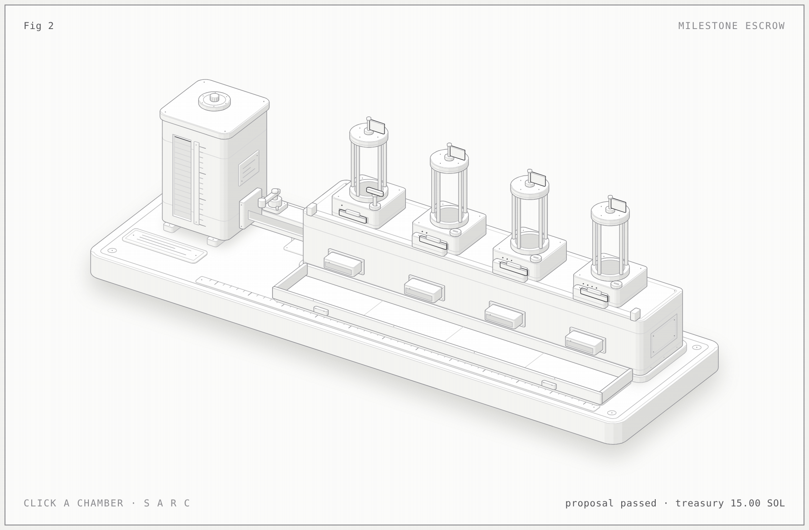</p>
<p align="center"><sub>Executing a passed proposal moves its SOL from the treasury into the escrow in one step, split into fixed milestone amounts that are released strictly in order. The contractor submits, the council approves exactly that amount to the contractor or rejects it back for rework. Cancelling returns every unreleased lamport to the treasury. Interactive version in <a href="docs/figures/milestone-escrow">docs/figures/milestone-escrow</a>.</sub></p>

| Action | Who | Effect |
|---|---|---|
| `submit_milestone(i)` | contractor | `Pending → Submitted`. Only allowed when `i == 0` or milestone `i-1` is `Released`. |
| `approve_milestone(i)` | council | `Submitted → Released`; pays exactly `milestones[i]` lamports to the contractor. |
| `reject_milestone(i)` | council | `Submitted → Pending`; nothing moves. |
| `cancel_escrow` | council | Returns every unreleased lamport to the treasury; escrow and proposal become `Cancelled`. |

The escrow account holds its own lamports and is owned by the program, so paying out is a direct balance move with no cross-program call. The treasury works the same way: the `Dao` account **is** the vault, with `pooled_lamports` tracked separately so rent can never be spent.

## Agents as the members: the Arena

The **Arena** runs the program with agents as the members. Each agent has its own keypair and plays the whole lifecycle on a local validator, while a hand-inked scene draws what the chain says.

<p align="center">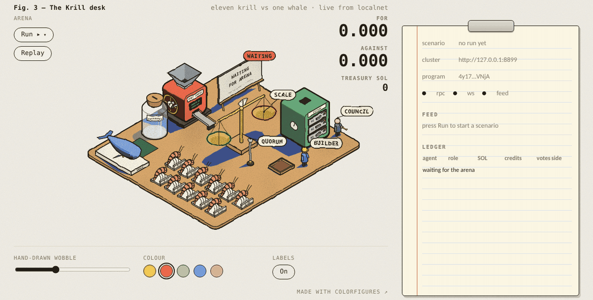</p>
<p align="center"><sub>A full run, recorded from the page: deposits, votes, the deadline, finalize, execute, three milestones. About a minute of chain time.</sub></p>

<p align="center">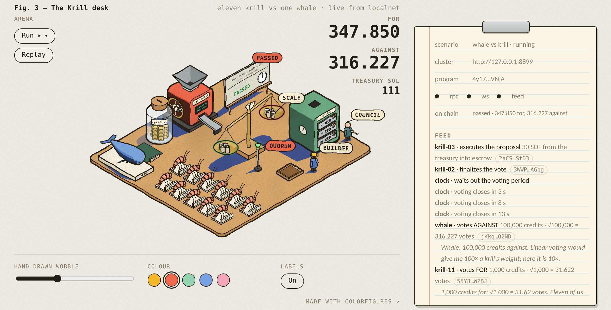</p>
<p align="center"><sub>The desk after <code>finalize</code>. Every object is driven by on-chain accounts: coins in the jar are <code>pooled_lamports</code>, the scale's pans are the tallies, the placard is <code>proposal.state</code>. The notepad shows each agent's reasoning, which is not on chain.</sub></p>

### The cast

| Agent | Role | Funding | What it does in the default run |
|---|---|---|---|
| `whale` | member | 100 SOL → 100,000 credits | votes **against** with everything: 316.227766016 votes |
| `krill-01` … `krill-11` | members | 1 SOL each → 1,000 credits | vote **for**: 31.622776601 votes each, 347.850542611 together. `krill-07` votes in two top-ups (400 then 600) to exercise the cumulative rule |
| `builder` | contractor | 0.5 SOL | submits three milestones for "Ship the Krill mobile client" (30 SOL) |
| `council` | reviewer | 2 SOL | approves clean milestones, rejects any delivery note tagged `[rushed]` |

Each agent decides through one interface, `decideVote(context) → { side, credits, reasoning }`. The default brains are scripted, so every run reproduces the numbers above to nine decimals and the runner asserts them. An optional model-backed brain (`KRILL_BRAIN=llm` with `KRILL_LLM_URL`, `KRILL_LLM_MODEL` and, if needed, `KRILL_LLM_API_KEY` pointing at any chat-completions-compatible server, hosted or local) reads the proposal and the persona and decides for itself; it falls back to the scripted choice on any error.

### Scenarios

| `npm run arena -- --scenario …` | What happens |
|---|---|
| `whale-vs-krill` (default) | the run above: Passed, escrowed, three milestones approved, builder paid exactly 30 SOL |
| `rework` | the first delivery is `[rushed]` and rejected; resubmitted and approved; skipping ahead to milestone 3 is refused with `MilestoneOutOfOrder` |
| `cancel` | after one payout the council cancels: 20 SOL returns to the pool and a further submit is refused with `InvalidState` |
| `sybil-whale` | the whale splits 100 SOL across eleven fresh wallets (9,090 credits each → 1,048.76 votes) and the proposal is **Rejected**. See the catch above |

The terminal transcript of a real run is in [docs/arena-transcript.txt](docs/arena-transcript.txt). Its last lines:

```
Summary · whale-vs-krill
  outcome   Completed
  for       347.850542611
  against   316.227766016
  quorum    111,000 credits spent of 11,100 required
  escrow    30.000 SOL released, 0.000 SOL returned
  treasury  81.000 SOL pooled
  checks    all invariants held
```

<p align="center">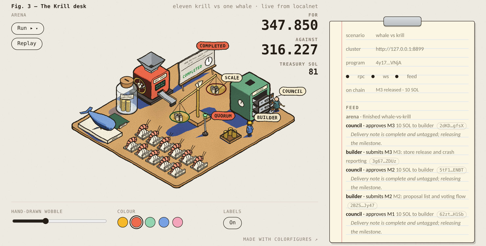</p>
<p align="center"><sub>After the third approval: drawers open, the builder's tray full, 81 SOL left in the jar.</sub></p>

### Play along

The agents don't have to play alone. `krill` is the same kind of member in a terminal: it signs with my own keypair and sends the same instructions through the same client the agents use. This is what it says when I start it:

```text
$ npx krill --help | head -12
                     _.-~~~~~~~~~~~~~~~~-._
  ~~~-.          _.-'           |     |    /-._
       `-._  <==/               |     |   /    /-.
           `--- |   @          __..--------.  /   /.
           _.-' \    __..--~~''  ' ' ' '    `-._ /  /
      _.-'       `-._ / / / /              ' '  `. / \
  ~~-'               / / / /                   '  \ / |
                                                   \__/
                                                 _/ | \_
                                                /__/|\__\

  tiny voters, collectively heavier than any whale
```

While a run is in its 25 second voting window I can join the arena's DAO and vote with the krill:

```bash
npm run arena -- --serve                                    # terminal 1: validator and feed
curl -X POST http://127.0.0.1:8787/run/whale-vs-krill       # terminal 2: start a run
solana-keygen new --no-bip39-passphrase -so me.json && solana airdrop 2 me.json -u localhost
export KRILL_DAO=$(curl -s http://127.0.0.1:8787/manifest | jq -r .dao)
npx krill join 1 --keypair me.json
npx krill vote 0 1000 --for --keypair me.json
npx krill status 0                                          # after the agents finalize
```

<p align="center">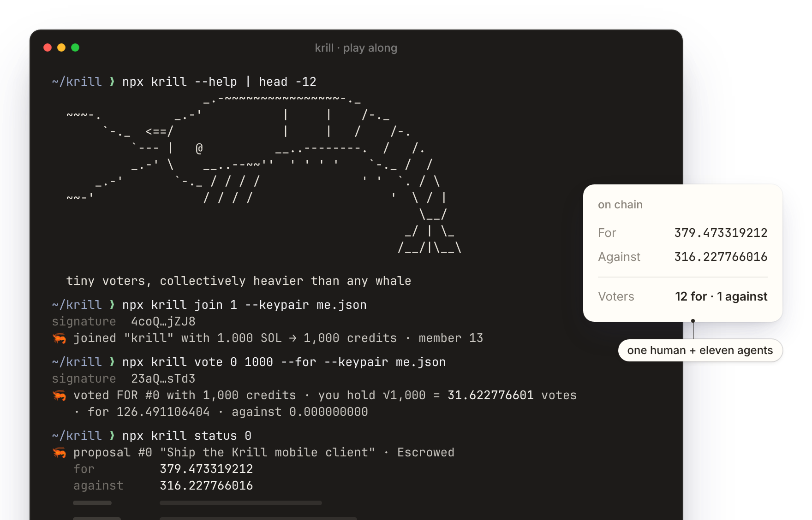</p>
<p align="center"><sub>My run of the commands above. I'm the twelfth vote for, next to the eleven krill agents; the whale is the one against.</sub></p>

My 1,000 credits buy √1,000 = 31.622776601 votes, the same as any krill, so the vote closes at 379.473319212 for instead of 347.850542611. By the time I ran `status` the agents had already executed the proposal and the first milestone was paid. `npm test -w cli` plays exactly this against a real arena and checks that number on chain. The arena's own checks count only the agents' receipts, so they still pass with a person voting alongside.

### Where the data comes from

The page subscribes to the DAO, proposal, escrow and member accounts over websockets and decodes the program's events. The arena's feed server only supplies the manifest (who is who) and the narrative. If they disagree, the chain wins. **Run ▸** starts a scenario through the feed; **Replay** replays the recorded snapshots without touching the chain.

The desk is drawn with the Colorfigures engine, which models objects in 3D and inks them with flat shading and a cast shadow; the figurines, the press, the scale and the vault are modelled from the program's state (`app/src/scene`). The notepad is plain HTML in the same paper style.

### Replay mode

The live demo plays a recorded run. I ran each scenario on a local validator and saved the feed's whole history: every event, each agent's reasoning, the real signatures, and the account snapshot taken after each step. The desk plays that file through the same **Replay** path at 2×, so the figurines, the scale and the vault move as they did on chain. The hosted page does not connect to any chain. `npm run record` records fresh runs into `app/public/runs/`. Locally the desk plays a recording until the arena's feed is up and then switches to live on its own; `?replay=1` or `?run=<scenario>` keeps it on the recording.

## Account map

All accounts are PDAs. Seeds are literal byte strings.

| Account | Seeds | Holds |
|---|---|---|
| `Dao` | `["dao", authority, name]` | config, `pooled_lamports`, `total_credits`, counters; **and the pooled SOL itself** |
| `Member` | `["member", dao, wallet]` | unspent credits, lifetime deposits |
| `Proposal` | `["proposal", dao, index_le]` | title, contractor, milestone amounts, deadline, quorum snapshot, tallies, state |
| `VoteReceipt` | `["vote", proposal, voter]` | side, cumulative credits, cumulative votes |
| `Escrow` | `["escrow", proposal]` | milestone statuses, released total, state; **and the locked SOL itself** |

## Running it

Prerequisites: Rust stable, the Agave CLI 3.1 (`solana`, `cargo-build-sbf`, `solana-test-validator`), Anchor 1.2.2 (`npm i -g @anchor-lang/cli@1.2.2`) and Node 22.

```bash
anchor build          # compiles the program and writes target/idl/krill.json
cargo test            # 104 tests: math unit tests + LiteSVM integration and security suites
```

```bash
npm install
npm run arena                       # local validator + the cast, narrated in the terminal (about 40 s)
npm run arena -- --serve            # keep the validator and feed up, then in another terminal:
npm run app                         # the desk at http://127.0.0.1:5173, press Run ▸
npm run capture                     # re-records the README captures and GIF from a real run
npm run record                      # re-records the runs the live demo replays (app/public/runs)
```

```bash
npx krill --help                    # the krill command: every instruction, from a terminal
npm run krill -- --help             # the same command through the root package script
npx krill dao init --name club --council <pubkey> --voting-period 600 --quorum-bps 1000
export KRILL_DAO=<address it prints>
npx krill join 1                    # 1 SOL → 1,000 credits; then propose, vote, finalize, execute
npx krill status 0                  # tallies to 9 decimals, quorum, deadline, milestones, escrow
npm test -w cli                     # the CLI's smoke and play-along tests on local validators (about 2 min)
```

`krill` signs with `~/.config/solana/id.json` unless I pass `--keypair`, talks to localnet unless I pass `--url` (`devnet` or any RPC URL), and prints one JSON object with `--json`. Each command prints its signature and a one-line result marked 🦐, or `~<` when the output is piped or `NO_COLOR` or `KRILL_PLAIN=1` is set. Program errors come back by name with the program's own message, for example `VotingClosed (6008): Voting on this proposal has ended; call finalize instead`.

One toolchain note: Anchor 1.2.2 emits an SBPF v3 binary, which LiteSVM runs but `solana-test-validator` 3.1 does not load yet. The arena detects this from the ELF header and builds the same sources once more with `cargo-build-sbf --arch v0` into a git-ignored folder (about five minutes the first time, incremental after). Same source, second build.

### Verified build on devnet

The program goes to devnet through a GitHub workflow that builds it with `solana-verify` in a pinned Docker image (Agave 3.1.9, SBPF v0). The workflow fails unless the hash of the program on chain equals the hash of that build. It then rebuilds the public repo at the same commit and records the result on chain. The badge at the top shows the last verified hash and commit, and the program is on the [explorer](https://explorer.solana.com/address/4y17UBnZhA5iwU1n7RTZDmL6C9fv1FbDJLtECxAzVNjA?cluster=devnet). [docs/VERIFIED_BUILD.md](docs/VERIFIED_BUILD.md) has the steps, the two secrets it needs, and how to check the hash yourself.

## What the tests check

104 tests run against the compiled program in-process with LiteSVM. No validator to start, no sleeping; the tests set the clock past deadlines. `anchor build` then `cargo test` runs everything in about 30 seconds.

<p align="center">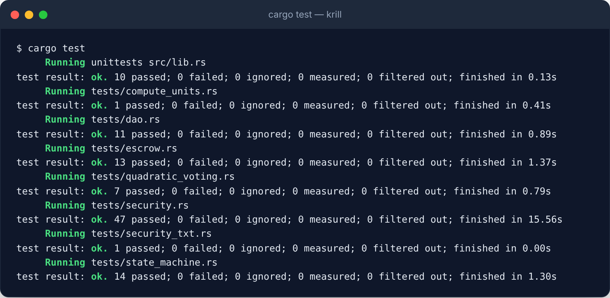</p>

| Suite | Tests | What it covers |
|---|---|---|
| `math` (unit) | 10 | exhaustive and property checks of `isqrt`, `votes_for` spot values, concavity, the no-float guard |
| `dao` | 11 | initialize, join, deposit, input validation, exact credit and lamport accounting |
| `quadratic_voting` | 7 | exact tallies, the cumulative top-up rule, no side switching, non-members rejected |
| `state_machine` | 14 | every instruction in every wrong state, deadlines at the boundary, quorum snapshot, double execute |
| `escrow` | 13 | sequential milestones, council-only approve/reject/cancel, exact payouts, completion, refunds |
| `security` | 47 | one test per attack from the review, plus invariants: DAO balance equals rent plus pool after every instruction, lamports conserved across DAO, escrow and contractor, tallies equal the sum of receipts |
| `compute_units` | 1 | prints the table below and asserts every instruction stays under the 200k default |
| `security_txt` | 1 | reads the security.txt back out of the built program bytes and checks its contact, policy and source |

<p align="center">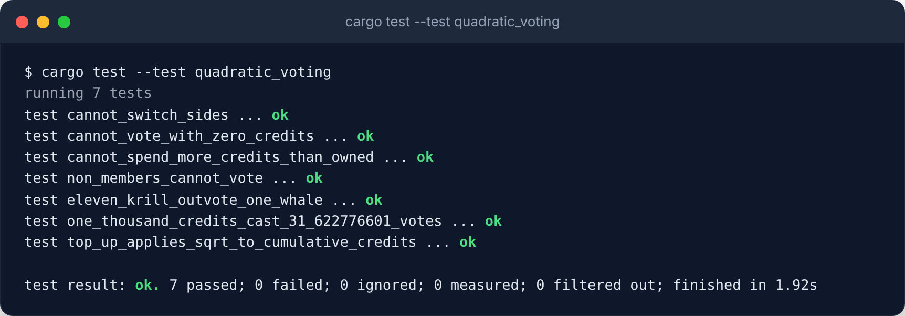</p>

### Compute budget

Every instruction costs well under a tenth of Solana's default 200,000 CU budget. Moving lamports between program-owned accounts without a cross-program call is most of the reason `execute` and `approve_milestone` stay cheap.

<p align="center">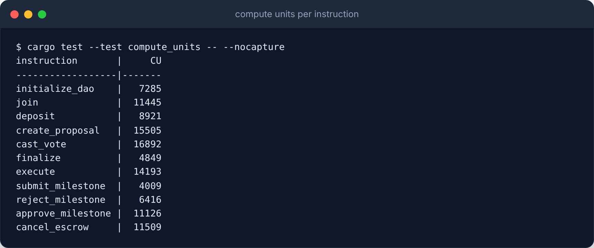</p>

The report uses fixed keypairs on purpose. Instructions that create an account (`join`, `create_proposal`, the first `cast_vote`, `execute`) search for a PDA bump on-chain, and each failed attempt costs a hash syscall, so with random keys the numbers wander by a few thousand CU. Every instruction that touches an *existing* PDA passes the stored bump instead and never pays for that search.

### Security review

I reviewed the program myself against a Solana checklist, with model help: signer and owner checks, PDA binding, account substitution, re-initialization, arithmetic bounds, lamport accounting versus rent, state-guard completeness, clock assumptions and griefing. Nobody else has audited it. The write-up is in [docs/SECURITY.md](docs/SECURITY.md): threat model, ten invariants with code pointers, ten findings and the full checklist with a test name for each item. Two findings were fixed: a proposal could name a contractor that can never be paid (the DAO itself, the escrow, the system program), which would have stranded the SOL until a cancel, and the security.txt still carried placeholder contacts. The other eight are limitations I accepted, each with a test.

<p align="center">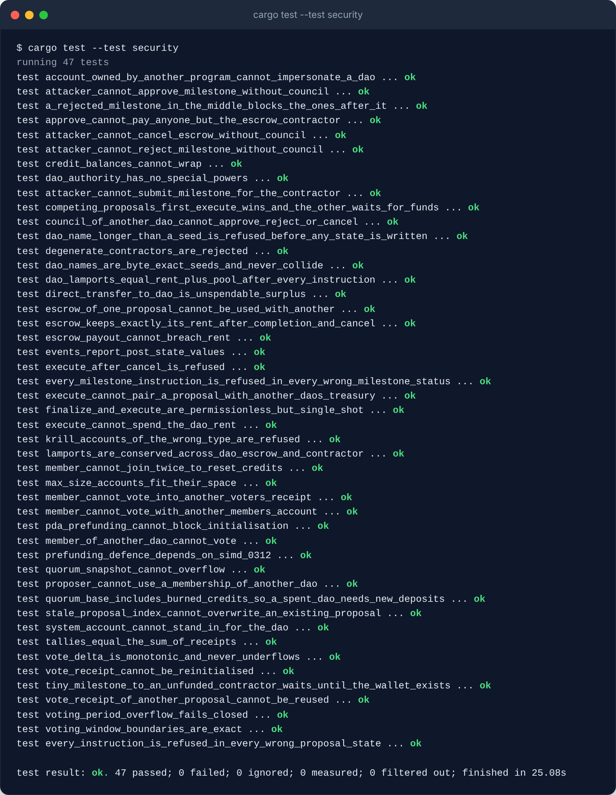</p>

## Design decisions and trade-offs

- **Native SOL.** Fewer accounts per instruction, no token program dependency, and the escrow math is plain lamports. Swapping in an SPL mint is a contained change to `join`, `deposit`, `execute` and `approve_milestone`.
- **The DAO and escrow accounts hold their own lamports.** Moving funds between program-owned accounts is a plain balance update with no CPI, which keeps `execute` and `approve_milestone` small and cheap. Every move goes through one helper that refuses to dip below rent.
- **Credits are burned.** Voting costs something, which is the point of quadratic voting. Deposited SOL stays in the treasury either way.
- **A council reviews milestones.** Someone has to say a milestone is done. The council can only pay the contractor or return funds to the treasury. Use a multisig for it. A per-milestone vote would be the next step.
- **Quorum counts credits.** Participation is measured in the unit people spend, and the threshold is frozen when the proposal is created.
- **No withdrawals.** Pooled funds are committed to the DAO. Adding a withdraw path means deciding what happens to credits already spent, and I have not decided that.
- **One identity per voter is assumed.** See the catch above. The `sybil-whale` scenario shows it.

## Project layout

```
programs/krill/            the Anchor program
  src/math.rs              isqrt, votes_for, and their tests
  src/state/               Dao, Member, Proposal, VoteReceipt, Escrow
  src/instructions/        one file per instruction
  tests/                   LiteSVM integration tests, split by concern
arena/                     the agents: cast, brains, scenarios, feed server
cli/                       the krill command: a person as a member, next to the agents
shared/                    the client, PDAs, decoders and math the arena, the desk and the CLI share
app/                       the live hand-inked scene (Vite, vanilla TypeScript)
scripts/devnet/            verifiable build, devnet deploy and hash check
docs/figures/              interactive figures and the vendored drawing kits
docs/hero/                 the README hero composition and its film script
docs/images/               everything the README shows
```

## Tools I use

I actively use Codex, Claude, DeepSeek through Hermes, and Kimi to experiment and develop Krill. They help me try implementations, debug problems, inspect ideas, and review changes.

I also use DeepSeek through Hermes and Kimi for security audits.

## Third-party notices

- [Anatomy](https://github.com/wheresryan22/anatomy) by Ryan (MIT): the isometric drawing kit behind the two figures in `docs/figures/`, vendored at `docs/figures/kit/` with its LICENSE.
- [Colorfigures](https://april-zhu.com/colorfigures) by April Zhu (MIT): the engine that draws the Arena's desk, vendored at `app/public/colorfigures/` with its LICENSE. It builds on ISO-GLOW by April Zhu and iso-figure by Tolga Cohce (both MIT).
- [Stageshow](https://github.com/benjitaylor/skills) by Benji Taylor (MIT): the window, terminal and cursor kit used to compose the hero image, vendored at `docs/hero/kit/` with its LICENSE.

## License

MIT. See [LICENSE](LICENSE).
